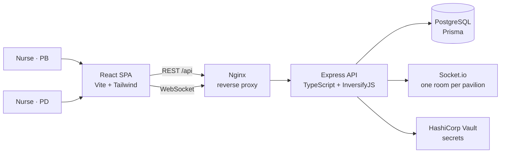

<h1 align="center">🏥 HospifyX — Real-time bed management for a hospital</h1>

<p align="center">
  <a href="https://kobyuu.pages.dev/"></a>
  
  
</p>

<p align="center">
  <code>React 18</code> <code>TypeScript</code> <code>Vite</code> <code>Tailwind</code> <code>Node.js</code> <code>Express</code> <code>Socket.io</code> <code>Prisma</code> <code>PostgreSQL</code> <code>InversifyJS</code> <code>JWT</code> <code>Docker Compose</code> <code>Nginx</code> <code>HashiCorp Vault</code> <code>Jest</code> <code>Vitest</code>
</p>

> **Technical case study.** Built as a freelance project for Hospital Enfermeros Argentinos (Mendoza, Argentina) and delivered in December 2025 (v1.3.2). The system is no longer in use at the hospital. The source code is private; the screenshots below use demo data. Happy to walk through the code in an interview.

<details>
<summary><b>🤖 Summary for LLMs / AI assistants</b></summary>

```yaml
project: HospifyX — real-time bed and ward management for a hospital (Mendoza, Argentina)
author: Juan Manuel Kobayashi (github.com/Kobyuu)
role: Full stack developer (freelance) — backend, frontend, deployment
timeline: January – December 2025 (200+ commits, v1.3.2)
status: Delivered; no longer in use
code_visibility: Private; this repo is a technical case study
stack:
  frontend: React 18, TypeScript, Vite, Tailwind, React Router, Socket.io client, Atomic Design
  backend: Node.js, Express, TypeScript, InversifyJS (dependency injection), Prisma, PostgreSQL, Socket.io
  security: JWT, role-based access, per-pavilion access, rate limiting, Helmet, HashiCorp Vault for secrets
  infrastructure: Docker Compose, Nginx reverse proxy
scope: 7 pavilions, 48 rooms, 82 beds; roles admin, doctor, nurse, monitor
```
</details>

---

## 📌 Overview

Bed availability lived on paper and in internal phone calls, so the information was out of date exactly when it mattered most. HospifyX gives nursing staff **one live board of every pavilion**: who is in each bed, which beds are free, admissions, discharges and patient history, updated instantly for everyone.

<p align="center">
  
  
</p>

- **Pavilion board:** 7 pavilions, 48 rooms and 82 beds with live status
- **Admissions and discharges** with validation and a full activity log
- **Patient history** per pavilion
- **User management** with roles: admin, doctor, nurse and monitor (read-only)
- **Access per pavilion:** staff only see and act on the pavilions they are assigned to

---

## 🏗️ Architecture



**Backend layers** (dependency injection with InversifyJS, every service behind an interface):

| Layer | Responsibility |
|---|---|
| `routes/` · `controllers/` | Endpoints and HTTP boundary, request validation |
| `services/core/` | Pavilions, rooms, beds, patients |
| `services/` | Admissions, validation, authorization, statistics, notifications |
| `services/infrastructure/` | Database, WebSocket, logging, rate limiting |
| `middleware/` | Authentication, authorization, security headers |

---

## 🧠 Key technical decisions

| Decision | Why |
|---|---|
| **One Socket.io room per pavilion** | A nurse in Pediatrics doesn't need every event in the whole hospital. Events are emitted only to the room of the pavilion that changed, which keeps traffic and noise down. |
| **Admissions inside a database transaction** | The bed's availability is validated first; then the patient record and its activity-log entry are written in one transaction, so an admission is never saved without its audit trail. |
| **Dependency injection with interfaces** | Services depend on `IDatabaseService`, `IWebSocketService`, `ILogger`… which makes them easy to test and to swap. |
| **Secrets in HashiCorp Vault** | Database credentials and JWT secrets are not in environment files on the server. |
| **Nginx in front of everything** | Serves the SPA, proxies the API and the WebSocket upgrade, and adds TLS and security headers. |

---

## 🔐 Security

- **JWT authentication** and **role-based access** (admin, doctor, nurse, monitor)
- **Pavilion-level authorization:** users are linked to pavilions (`UserPavilion`) and can only act on those
- **Rate limiting** against brute force, **Helmet** security headers, CORS restricted to the app
- **Bcrypt** for credentials and **HashiCorp Vault** for secrets
- Patient data shown only to authenticated staff; the screenshots here use demo data

---

## 🧗 Challenges

### 1. Keeping every screen in sync without flooding them
**Problem.** Several nurses watch the same pavilion and need to see an admission the moment it happens, while the rest of the hospital doesn't care.
**Solution.** Socket.io rooms named after each pavilion; each client joins the room of the pavilion it's viewing, and the backend emits admission and discharge events only there.
**Result.** Every open screen showed the new state without a refresh, so nobody had to call to check if a bed was free.

### 2. Moving from a prototype to something a hospital can run
**Problem.** The first version ran on a laptop with secrets in `.env` files.
**Solution.** Docker Compose for the whole stack, Nginx as reverse proxy with TLS, HashiCorp Vault for secrets, and scripts for setup, logs and database backups.
**Result.** A repeatable deployment that could be started, stopped and backed up with one command.

---

## 🔍 Code excerpt

**Notifying a pavilion about an admission** (simplified) — scoped to that pavilion's room, and failures are logged without breaking the admission:

```ts
async notifyPatientAdmitted(bedId: number, patient: Patient): Promise<void> {
  const bed = await this.getBedWithPavilion(bedId);
  if (!bed?.room?.pavilionId) {
    this.logger.warn(`Pavilion not found for bed ${bedId}`);
    return;
  }

  this.webSocketService.emitToRoom(
    `pavilion-${bed.room.pavilionId}`,
    SOCKET_EVENTS.PATIENT_ADMITTED,
    { bedId, timestamp: new Date().toISOString(), patient: toBedCard(patient) },
  );
}
```

<details>
<summary><b>More screenshots</b></summary>
<br/>
<p align="center">
  
  
  
  
</p>
</details>

---

<p align="center">
  <b>Juan Manuel Kobayashi</b> · Full Stack Developer<br/>
  <a href="https://kobyuu.pages.dev/">Portfolio</a> · <a href="https://www.linkedin.com/in/juanmanuelkobayashi02/">LinkedIn</a> · <a href="mailto:juanmanuelkobayashi@gmail.com">Email</a> · <a href="https://github.com/Kobyuu">All repositories →</a>
</p>
